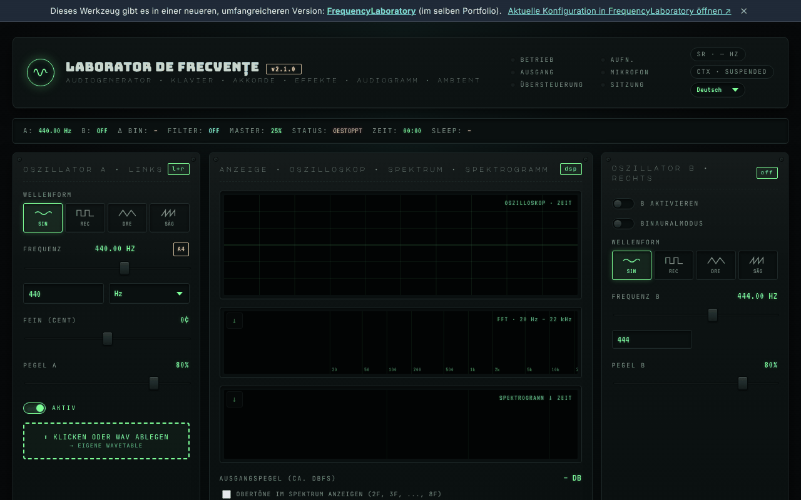

# Frequenzlabor (generator-frecvente)

[English](README.md) · [Română](README.ro.md) · [Français](README.fr.md) · [Italiano](README.it.md) · [Español](README.es.md) · [Português](README.pt.md) · **Deutsch** · [Magyar](README.hu.md)

**Version:** 2.2.7 · **Zuletzt aktualisiert:** 2026-10-22

Oberflächensprachen: **Română, English, Français, Italiano, Español, Português (PT), Deutsch, Magyar**

**Online / Demo:** https://chiuta.github.io/generator-frecvente/

Audio-Werkzeug in einer einzigen HTML-Datei (`index.html`), das im Browser über die Web Audio API läuft: A/B-Oszillatoren (auch im Binauralmodus), Sequenzer, Equalizer, Umgebungsgeräusche, Frequenz-Presets, Aufnahme, Messungen mit dem Mikrofon und ein orientierender Hörtest.

**Informativer/bildender Inhalt; ersetzt keine ärztliche Beratung.** Die Kategorien „Solfeggio“ und „Schumann“ stammen aus modernen (New-Age-)Traditionen und sind wissenschaftlich nicht belegt; es werden keine therapeutischen Wirkungen versprochen. Der Hörtest zeigt eine relative Schwelle und ist kein medizinisches Audiogramm. Presets mit Namen wie „Befreiung von Angst“ oder ähnlich haben keine nachgewiesene medizinische Wirkung. Bei Tinnitus oder Hörproblemen wende dich an einen HNO-Arzt. Halte die Lautstärke niedrig und verwende Kopfhörer mit Vorsicht.

## Verwendung
Öffne `index.html` in einem modernen Browser (oder die über GitHub Pages veröffentlichte Version). Drücke „Start“, um den Ton zu starten; die Tastenkürzel sind auf der Seite beschrieben (Taste `?`).

## Daten und Datenschutz
Per Audit überprüft: Die Seite sendet keine Netzwerkanfragen (es gibt kein `fetch`, kein CDN und keine externen Schriftarten; die Schriftarten sind eingebettet). Das Mikrofon wird nur verwendet, wenn du es ausdrücklich aktivierst, und das Signal wird lokal verarbeitet. Einstellungen können in `localStorage` gespeichert werden. Die einzigen externen Links sind die für freiwillige Unterstützung und die Website des Autors.

## Einschränkungen
Das Verhalten hängt vom Browser ab (Web Audio, MIDI, AudioWorklet). Im selben Portfolio gibt es eine neuere Version des Werkzeugs: [FrequencyLaboratory](https://chiuta.github.io/FrequencyLaboratory/) (der Link erscheint auch im Banner der Seite).

## Verlauf / Changelog
- **2.2.7 — 2026-10-22:** Touch-Ziele: das Kontrollkästchen „Harmonische im Spektrum zeigen“ liegt in einem Label von mindestens 24 px Höhe. Erneute Prüfung bei 360 und 1366 px (Anfangszustand, aufgeklappte Abschnitte, verborgene Panels): kein Ziel unter 24 px und kein Text unter 12 px mehr.

### 2.2.6 — 2026-10-22
- fff-kit 1.1.4: Touch-Ziele und Mindestschriftgröße; Touch-Ziele/Text korrigiert

### 2.2.5 — 2026-10-22
- fff-kit 1.1.2: PBKDF2 mit 600.000 Iterationen, Schutz vor Clickjacking.

### 2.2.4 — 2026-10-22

eigene `localStorage`-Schlüssel mit dem Präfix `generator-frecvente.`, automatisch aus den alten `lab_frecv_`-Schlüsseln migriert (die auf derselben Origin mit FrequencyLaboratory kollidierten: Presets und Design überschrieben sich gegenseitig); das technische Etikett listet jetzt die 8 Oberflächensprachen; die versteckten Dateifelder sind in jeder Sprache beschriftet; sichtbarer Tastaturfokus; der Banner-Link bricht auf schmalen Bildschirmen um. Feinschliff für Mobilgeräte und Barrierefreiheit: Text mit mindestens 12 px und Touch-Ziele von mindestens 24 px.

### 2.2.3 — 2026-10-22
- Rund 50 aria-label/title-Attribute, die auf Englisch geblieben waren (auch im Rumänischen), sind in allen 8 Sprachen übersetzt; die Standardnamen der Phasen („Phase 1/4“) folgen der Oberflächensprache und werden sofort aktualisiert.

### 2.2.2 — 2026-10-22
- Der Panel-Titel „Design · Teilen“ ist jetzt auch auf Rumänisch übersetzt („partajare“).

- 2.1.1 — 2026-10-19: Im Banner ein Link „Aktuelle Konfiguration in FrequencyLaboratory öffnen“ (der aktuelle Zustand im Fragment `#state=`, neuer Tab; keine Netzwerkanfragen).
- 2.1.0 — 2026-10-14: Datensicherung und Datenkennzeichnung (fff-kit).

- 2.0.4 — 2026-10-12: Die Version und das Datum der letzten Aktualisierung werden in der Anwendung angezeigt
- Beim Start erscheinen die 6 Benachrichtigungen „v2.0: …“ nicht mehr (Versionshinweise, die die Oberfläche ~10 s lang überlagerten, vor allem auf Mobilgeräten); es bleibt nur der einmalige Hinweis beim ersten Start. Der Benachrichtigungsstapel ist auf 3 begrenzt (die älteste wird entfernt).
- Preset-Bibliothek: Suchfeld in allen 6 Kategorien (Name, Beschreibung, Frequenz; ohne Beachtung von Diakritika, mehrere Begriffe), mit Zähler und Meldung bei null Treffern; ein Tipp auf ein Kategorie-Label leert die Suche. CSP: `script-src` per SHA-256-Hash, ohne `'unsafe-inline'` (blob: bleibt für AudioWorklet/Worker erlaubt).
- Der Inhalt ist nun in `<main>` eingefasst, das Banner „neuere Version“ ist ein `aside`, und die Überschriften im Notizenbereich sind h2 (korrekte Reihenfolge h1 → h2); das BPM-Feld des Metronoms hat eine zugängliche Beschriftung. axe-core: 0 Verstöße bei 1280 und 360 px.
- Auf schmalen Bildschirmen (360 px) verursacht der Notizenbereich kein horizontales Scrollen der Seite mehr.
- Benachrichtigungen (Toasts) sind nun eine `status`-Region für Screenreader.
- Die Versionsnummer wurde in Titel, Kopfzeile und Fußzeile angehoben (v2.0 → v2.0.1 → v2.0.2). Die neuere Version bleibt [FrequencyLaboratory](https://chiuta.github.io/FrequencyLaboratory/).

## Lizenz
MIT, gemäß dem Kopfbereich von `index.html`; siehe `LICENSE`.

Audit: 2026-10-10
