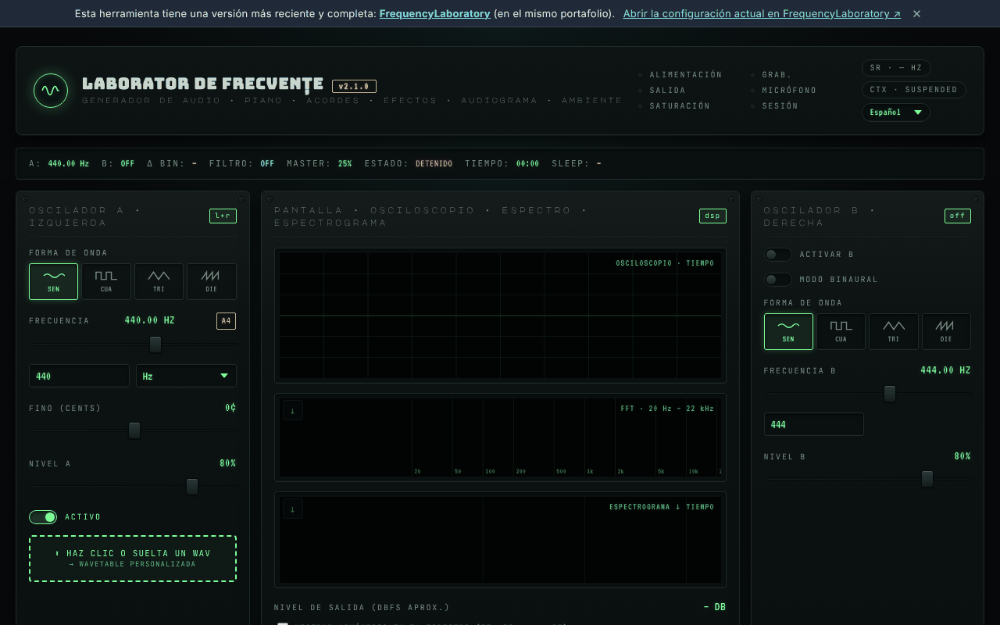

# Laboratorio de frecuencias (generator-frecvente)

[English](README.md) · [Română](README.ro.md) · [Français](README.fr.md) · [Italiano](README.it.md) · **Español** · [Português](README.pt.md) · [Deutsch](README.de.md) · [Magyar](README.hu.md)

**Versión:** 3.1.0 · **Última actualización:** 2026-10-27

**Estado:** estable · **Sin conexión:** completo

Idiomas de la interfaz: **Română, English, Français, Italiano, Español, Português (PT), Deutsch, Magyar**

**En línea / demo:** https://chiuta.github.io/generator-frecvente/

Herramienta de audio en un único archivo HTML (`index.html`), ejecutada en el navegador mediante la Web Audio API: osciladores A/B (incluido el modo binaural), secuenciador, ecualizador, sonidos ambientales, preajustes de frecuencias, grabación, mediciones con el micrófono y una prueba auditiva orientativa.

**Contenido informativo y educativo; no sustituye el consejo médico.** Las categorías «Solfeggio» y «Schumann» proceden de tradiciones modernas (New Age) y carecen de validación científica; no se promete ningún efecto terapéutico. La prueba auditiva muestra un umbral relativo y no es una audiometría médica. Los preajustes con nombres del tipo «liberación del miedo» o similares no tienen ningún efecto médico demostrado. Si tienes tinnitus o problemas de audición, consulta a un otorrinolaringólogo. Mantén el volumen bajo y usa los auriculares con precaución.

## Uso
Abre `index.html` en un navegador moderno (o la versión publicada mediante GitHub Pages). Pulsa «Start» para iniciar el sonido; los atajos se describen en la página (tecla `?`).

## Datos y privacidad
Verificado mediante auditoría: la página no realiza solicitudes de red (no hay `fetch`, CDN ni fuentes externas; las fuentes están incorporadas). El micrófono solo se usa si lo activas de forma explícita, y la señal se procesa localmente. Los ajustes pueden conservarse en `localStorage`. Los únicos enlaces externos son los de apoyo voluntario y el sitio del autor.

## Limitaciones
El comportamiento depende del navegador (Web Audio, MIDI, AudioWorklet). Existe una versión más reciente de la herramienta en el mismo portafolio: [FrequencyLaboratory](https://chiuta.github.io/FrequencyLaboratory/) (el enlace aparece también en el banner de la página).

## Protección auditiva y limitador de volumen (3.1.0)

Al iniciar aparece una advertencia con confirmación («Entendido — activar el sonido»): hasta entonces la salida de audio está en silencio. Incluye un **limitador de volumen** (techo para todo el sonido hacia altavoces/auriculares, incluida la prueba auditiva): −6 dB por defecto, ajustable de −30 dB a 0 dB desde la etiqueta «LÍMITE … dB» de la cabecera; el límite se guarda en `localStorage` (`generator-frecvente.volcap`) y la confirmación solo durante la sesión. El volumen «Master» queda dentro del límite; los archivos grabados (WAV) no se ven afectados. No es un producto sanitario: empieza con el volumen del dispositivo al mínimo.

## Véase también: FrequencyLaboratory

**Frequency Laboratory (generator-frecvente)** (esta aplicación) y **FrequencyLaboratory** comparten base de código y se solapan mucho. FrequencyLaboratory es la versión más nueva y completa; esta conserva la interfaz clásica de un solo panel y añade la biblioteca de escenas. Las dos aplicaciones NO se han fusionado; usan claves de almacenamiento separadas y pueden pasarse la configuración mediante un enlace (`#state=`).

## Historial / Changelog

- **3.1.0 — 2026-10-27:** advertencia de protección auditiva con confirmación antes del primer sonido + limitador de volumen (techo, −6 dB por defecto, ajustable); nota «véase también» FrequencyLaboratory; líneas Estado/Sin conexión; CHANGELOG.md (anterior: v3.0.0).
- **2.2.9 — 2026-10-23:** fff-kit 1.2.0: han desaparecido las últimas llamadas nativas a `alert`/`confirm`/`prompt`: los mensajes aparecen como notificaciones accesibles (aria-live, en el idioma de la interfaz) y borrar un favorito con una pulsación larga pide confirmación en el diálogo `FFF.dialog` del kit. Las etiquetas «Mode m / Mode n» están ahora traducidas a los 8 idiomas.
- **2.2.7 — 2026-10-22:** Objetivos táctiles: la casilla «mostrar armónicos en el espectro» está en una etiqueta de al menos 24 px de alto. Nueva auditoría a 360 y 1366 px (estado inicial, secciones expandidas, paneles ocultos): no queda ningún objetivo por debajo de 24 px ni texto por debajo de 12 px.

### 2.2.6 — 2026-10-22
- fff-kit 1.1.4: objetivos táctiles y texto mínimo; objetivos táctiles/texto corregidos

### 2.2.5 — 2026-10-22
- fff-kit 1.1.2: PBKDF2 con 600.000 iteraciones, protección anti-clickjacking.

### 2.2.4 — 2026-10-22

claves `localStorage` propias con el prefijo `generator-frecvente.`, migradas automáticamente desde las antiguas claves `lab_frecv_` (que colisionaban con FrequencyLaboratory en el mismo origen: los preajustes y el tema se sobrescribían); la etiqueta técnica enumera ahora los 8 idiomas de la interfaz; los campos de archivo ocultos tienen etiqueta en cada idioma; foco de teclado visible; el enlace del banner se ajusta en pantallas estrechas. mejoras para móvil y accesibilidad: texto de al menos 12 px y áreas táctiles de al menos 24 px.

### 2.2.3 — 2026-10-22
- Unos 50 atributos aria-label/title que seguían en inglés (también en rumano) están traducidos a los 8 idiomas; los nombres de etapa predeterminados («Etapa 1/4») siguen el idioma de la interfaz y se actualizan al instante.

### 2.2.2 — 2026-10-22
- El título del panel «tema · compartir» ya está traducido también al rumano («partajare»).

- 2.1.1 — 2026-10-19: en el banner, un enlace «Abrir la configuración actual en FrequencyLaboratory» (el estado actual en el fragmento `#state=`, en una pestaña nueva; sin solicitudes de red).
- 2.1.0 — 2026-10-14: copia de seguridad y etiquetado de datos (fff-kit).

- 2.0.4 — 2026-10-12: la versión y la fecha de la última actualización se muestran en la aplicación
- Al iniciar ya no aparecen las 6 notificaciones «v2.0: …» (notas de versión que se superponían a la interfaz durante ~10 s, sobre todo en móvil); solo queda la sugerencia única de primer inicio. La pila de notificaciones se limita a 3 (la más antigua se elimina).
- Biblioteca de preajustes: campo de búsqueda en las 6 categorías (nombre, descripción, frecuencia; sin distinguir diacríticos, varios términos), con contador y mensaje cuando no hay resultados; al pulsar la etiqueta de una categoría se vacía la búsqueda. CSP: `script-src` mediante hash SHA-256, sin `'unsafe-inline'` (blob: sigue permitido para AudioWorklet/worker).
- El contenido está ahora envuelto en `<main>`, el banner de «versión más reciente» es un `aside` y los títulos del panel de notas son h2 (orden h1 → h2 correcto); el campo BPM del metrónomo tiene una etiqueta accesible. axe-core: 0 infracciones a 1280 y 360 px.
- En pantallas estrechas (360 px) el panel de notas ya no provoca desplazamiento horizontal de la página.
- Las notificaciones (toasts) son ahora una región `status` para lectores de pantalla.
- El número de versión se actualizó en el título, la cabecera y el pie de página (v2.0 → v2.0.1 → v2.0.2). La versión más reciente sigue siendo [FrequencyLaboratory](https://chiuta.github.io/FrequencyLaboratory/).

## Licencia
MIT, según la cabecera de `index.html`; véase `LICENSE`.

Auditoría: 2026-10-10
