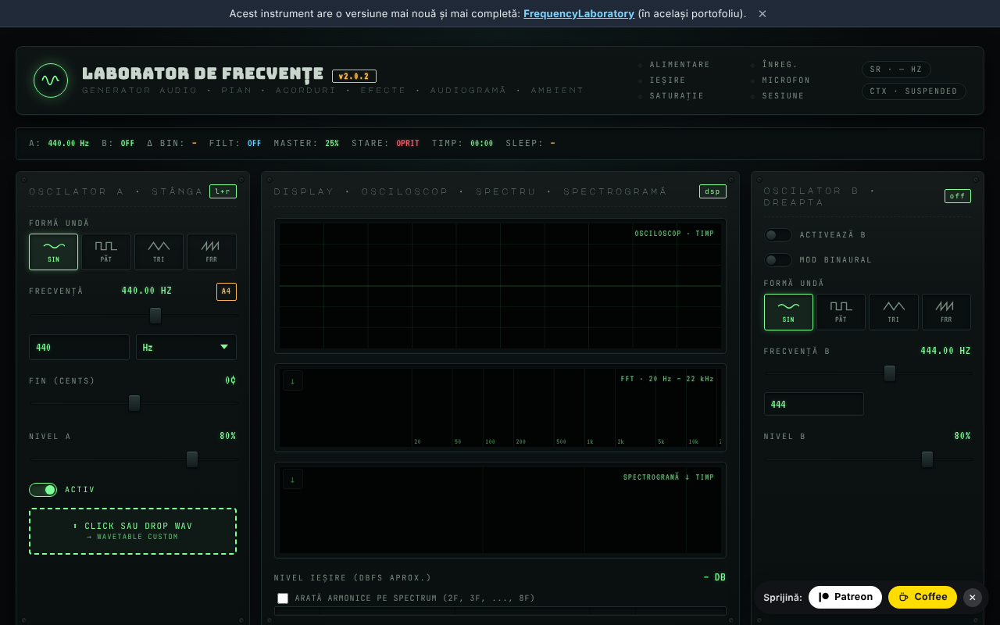

# Laboratoire de fréquences (generator-frecvente)

[English](README.md) · [Română](README.ro.md) · **Français** · [Italiano](README.it.md) · [Español](README.es.md) · [Português](README.pt.md) · [Deutsch](README.de.md) · [Magyar](README.hu.md)

**Version :** 2.1.1 · **Dernière mise à jour :** 2026-10-19

**En ligne / démo :** https://chiuta.github.io/generator-frecvente/

Outil audio en un seul fichier HTML (`index.html`), exécuté dans le navigateur via la Web Audio API : oscillateurs A/B (y compris en mode binaural), séquenceur, égaliseur, sons d'ambiance, préréglages de fréquences, enregistrement, mesures au microphone et test auditif indicatif.

**Contenu informatif et éducatif ; il ne remplace pas un avis médical.** Les catégories « Solfeggio » et « Schumann » proviennent de traditions modernes (New Age) et n'ont aucune validation scientifique ; aucun effet thérapeutique n'est promis. Le test auditif indique un seuil relatif et n'est pas un audiogramme médical. Les préréglages portant des noms du type « libération de la peur » ou similaires n'ont aucun effet médical prouvé. En cas d'acouphènes ou de problèmes d'audition, consultez un médecin ORL. Gardez le volume bas et utilisez un casque avec prudence.

## Utilisation
Ouvrez `index.html` dans un navigateur récent (ou la version publiée via GitHub Pages). Appuyez sur « Start » pour lancer le son ; les raccourcis sont décrits dans la page (touche `?`).

## Données et confidentialité
Vérifié par audit : la page n'effectue aucune requête réseau (pas de `fetch`, de CDN ni de polices externes ; les polices sont intégrées). Le microphone n'est utilisé que si vous l'activez explicitement, et le signal est traité localement. Les réglages peuvent être conservés dans `localStorage`. Les seuls liens externes sont ceux du soutien volontaire et le site de l'auteur.

## Limites
Le comportement dépend du navigateur (Web Audio, MIDI, AudioWorklet). Une version plus récente de l'outil existe dans le même portefeuille : [FrequencyLaboratory](https://chiuta.github.io/FrequencyLaboratory/) (le lien figure aussi dans la bannière de la page).

## Historique / Changelog

- 2.1.1 — 2026-10-19 : dans la bannière, un lien « Ouvrir la configuration actuelle dans FrequencyLaboratory » (l'état courant dans le fragment `#state=`, nouvel onglet ; sans requêtes réseau).
- 2.1.0 — 2026-10-14 : sauvegarde et étiquetage des données (fff-kit).

- 2.0.4 — 2026-10-12 : la version et la date de dernière mise à jour sont affichées dans l'application
- Au démarrage, les 6 notifications « v2.0 : … » n'apparaissent plus (notes de version qui se superposaient à l'interface pendant ~10 s, surtout sur mobile) ; seule reste la suggestion unique de premier démarrage. La pile de notifications est limitée à 3 (la plus ancienne est supprimée).
- Bibliothèque de préréglages : champ de recherche dans les 6 catégories (nom, description, fréquence ; insensible aux diacritiques, plusieurs termes), avec compteur et message en l'absence de résultat ; un appui sur une étiquette de catégorie vide la recherche. CSP : `script-src` par hachage SHA-256, sans `'unsafe-inline'` (blob: reste autorisé pour AudioWorklet/worker).
- Le contenu est désormais encadré par `<main>`, la bannière « version plus récente » est un `aside`, et les titres du panneau de notes sont des h2 (ordre h1 → h2 correct) ; le champ BPM du métronome possède une étiquette accessible. axe-core : 0 violation à 1280 et 360 px.
- Sur les écrans étroits (360 px), le panneau de notes ne provoque plus de défilement horizontal de la page.
- Les notifications (toasts) sont désormais une région `status` pour les lecteurs d'écran.
- Le numéro de version a été relevé dans le titre, l'en-tête et le pied de page (v2.0 → v2.0.1 → v2.0.2). La version plus récente reste [FrequencyLaboratory](https://chiuta.github.io/FrequencyLaboratory/).

## Licence
MIT, conformément à l'en-tête de `index.html` ; voir `LICENSE`.

Audit : 2026-10-10
