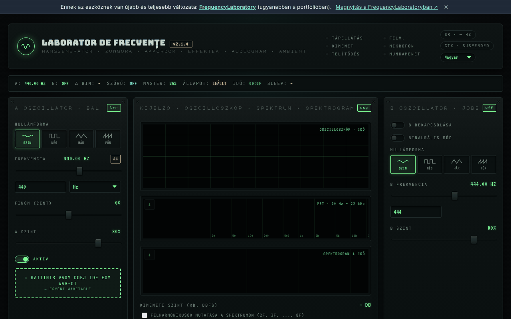

# Frekvencialabor (generator-frecvente)

[English](README.md) · [Română](README.ro.md) · [Français](README.fr.md) · [Italiano](README.it.md) · [Español](README.es.md) · [Português](README.pt.md) · [Deutsch](README.de.md) · **Magyar**

**Verzió:** 3.1.0 · **Utolsó frissítés:** 2026-10-27

**Állapot:** stabil · **Offline:** teljes

A felület nyelvei: **Română, English, Français, Italiano, Español, Português (PT), Deutsch, Magyar**

**Online / bemutató:** https://chiuta.github.io/generator-frecvente/

Egyetlen HTML-fájlban (`index.html`) működő hangeszköz, amely a böngészőben fut a Web Audio API-n keresztül: A/B oszcillátorok (binaurális móddal együtt), szekvenszer, hangszínszabályzó, környezeti hangok, frekvencia-előbeállítások, felvétel, mikrofonos mérések és tájékoztató jellegű hallásteszt.

**Tájékoztató/oktatási tartalom; nem helyettesíti az orvosi tanácsot.** A „Solfeggio” és a „Schumann” kategória modern (New Age) hagyományokból ered, tudományos megalapozottsága nincs; terápiás hatást nem ígérünk. A hallásteszt relatív küszöböt mutat, nem orvosi audiogram. A „félelemtől való megszabadulás” vagy hasonló nevű előbeállításoknak nincs bizonyított orvosi hatása. Fülzúgás vagy halláspróbléma esetén fordulj fül-orr-gégész orvoshoz. Tartsd alacsonyan a hangerőt, és óvatosan használd a fejhallgatót.

## Használat
Nyisd meg az `index.html` fájlt egy modern böngészőben (vagy a GitHub Pages-en közzétett változatot). A hang elindításához nyomd meg a „Start” gombot; a billentyűparancsok az oldalon vannak leírva (`?` billentyű).

## Adatok és adatvédelem
Auditálással ellenőrizve: az oldal nem küld hálózati kéréseket (nincs `fetch`, CDN vagy külső betűtípus; a betűtípusok be vannak ágyazva). A mikrofont csak akkor használja, ha kifejezetten engedélyezed, a jelet pedig helyben dolgozza fel. A beállítások a `localStorage`-ban őrizhetők meg. Az egyetlen külső hivatkozás az önkéntes támogatásé és a szerző weboldala.

## Korlátozások
A működés a böngészőtől függ (Web Audio, MIDI, AudioWorklet). Az eszköz újabb változata létezik ugyanebben a portfólióban: [FrequencyLaboratory](https://chiuta.github.io/FrequencyLaboratory/) (a hivatkozás az oldal bannerében is megjelenik).

## Halláskárosodás elleni védelem és hangerőkorlátozó (3.1.0)

Induláskor megerősítést kérő figyelmeztetés jelenik meg („Értem — hang bekapcsolása”): addig a hangkimenet néma. Beépített **hangerőkorlátozó** (felső határ a hangszórókra/fejhallgatóra küldött teljes hangra, a hallásvizsgálatot is beleértve): alapértelmezés −6 dB, −30 dB és 0 dB között állítható a fejléc „KORLÁT … dB” jelvényén; a korlát a `localStorage`-ban marad (`generator-frecvente.volcap`), a megerősítés csak a munkamenetre érvényes. A „Master” hangerő a korláton belül marad; a felvett (WAV) fájlokat nem érinti. Nem orvostechnikai eszköz: a készülék hangerejét kezdetben a minimumra állítsd.

## Lásd még: FrequencyLaboratory

A **Frequency Laboratory (generator-frecvente)** (ez az alkalmazás) és a **FrequencyLaboratory** közös kódalapról indul, és erősen átfedik egymást. A FrequencyLaboratory az újabb, teljesebb változat; ez a klasszikus egypaneles felületet őrzi, és hozzáadja a jelenettárat. A két alkalmazást NEM vontuk össze; külön tárolókulcsokat használnak, és hivatkozással (`#state=`) átadhatják egymásnak a beállítást.

## Előzmények / Changelog

- **3.1.0 — 2026-10-27:** hallásvédelmi figyelmeztetés megerősítéssel az első hang előtt + hangerőkorlátozó (felső határ, alapértelmezés −6 dB, állítható); „lásd még” megjegyzés a FrequencyLaboratory-hoz; Állapot/Offline sorok; CHANGELOG.md (előző: v3.0.0).
- **2.2.9 — 2026-10-23:** fff-kit 1.2.0: megszűntek az utolsó natív `alert`/`confirm`/`prompt` hívások: az üzenetek akadálymentes értesítésként (aria-live, a felület nyelvén) jelennek meg, egy kedvenc hosszú nyomással történő törlése pedig a készlet `FFF.dialog` párbeszédablakában kér megerősítést. A „Mode m / Mode n” címkék most mind a 8 nyelven le vannak fordítva.
- **2.2.7 — 2026-10-22:** Érintési célpontok: a „felharmonikusok mutatása a spektrumon” jelölőnégyzet legalább 24 px magas címkében van. Újabb ellenőrzés 360 és 1366 px-en (kezdőállapot, kinyitott szakaszok, rejtett panelek): nem marad 24 px alatti célpont és 12 px alatti szöveg.

### 2.2.6 — 2026-10-22
- fff-kit 1.1.4: érintési célpontok és minimális szövegméret; érintési célpontok/szöveg javítva

### 2.2.5 — 2026-10-22
- fff-kit 1.1.2: PBKDF2 600 000 iterációval, clickjacking elleni védelem.

### 2.2.4 — 2026-10-22

saját `localStorage` kulcsok `generator-frecvente.` előtaggal, a régi `lab_frecv_` kulcsokból automatikusan átemelve (amelyek ugyanazon az origin-en ütköztek a FrequencyLaboratoryval: az előbeállítások és a téma felülírták egymást); a műszaki címke most felsorolja a felület 8 nyelvét; a rejtett fájlmezők minden nyelven fel vannak címkézve; látható billentyűzetfókusz; a szalag hivatkozása keskeny képernyőn tördelődik. mobil és kisegítő finomítások: legalább 12 px-es szöveg és legalább 24 px-es érintési felületek.

### 2.2.3 — 2026-10-22
- Mintegy 50, angolul maradt aria-label/title attribútum (románul is) mind a 8 nyelven le van fordítva; az alapértelmezett szakaszelnevezések („1/4. szakasz”) követik a felület nyelvét, és nyelvváltáskor azonnal frissülnek.

### 2.2.2 — 2026-10-22
- A „téma · megosztás” panelcím mostantól románul is le van fordítva („partajare”).

- 2.1.1 — 2026-10-19: a bannerben „A jelenlegi konfiguráció megnyitása a FrequencyLaboratoryban” hivatkozás (a jelenlegi állapot a `#state=` töredékben, új lapon; hálózati kérések nélkül).
- 2.1.0 — 2026-10-14: adatmentés és adatcímkézés (fff-kit).

- 2.0.4 — 2026-10-12: a verzió és az utolsó frissítés dátuma megjelenik az alkalmazásban
- Indításkor már nem jelenik meg a 6 db „v2.0: …” értesítés (a kiadási megjegyzések ~10 másodpercig rácsúsztak a felületre, főleg mobilon); csak az egyszeri első indítási javaslat maradt. Az értesítési verem 3 elemre korlátozott (a legrégebbi törlődik).
- Előbeállítás-könyvtár: keresőmező mind a 6 kategóriában (név, leírás, frekvencia; ékezetfüggetlen, több kifejezéssel), számlálóval és üzenettel nulla találat esetén; egy kategóriacímkére nyomva a keresés kiürül. CSP: `script-src` SHA-256 hash alapján, `'unsafe-inline'` nélkül (a blob: továbbra is engedélyezett az AudioWorklethez/workerhez).
- A tartalom mostantól `<main>` elembe van foglalva, az „újabb verzió” banner `aside`, a jegyzetpanel címsorai pedig h2 szintűek (helyes h1 → h2 sorrend); a metronóm BPM-mezője hozzáférhető címkét kapott. axe-core: 0 hiba 1280 és 360 px szélességnél.
- Keskeny képernyőkön (360 px) a jegyzetpanel már nem okoz vízszintes görgetést az oldalon.
- Az értesítések (toast) mostantól `status` régiók a képernyőolvasók számára.
- A verziószám megemelkedett a címben, a fejlécben és a láblécben (v2.0 → v2.0.1 → v2.0.2). Az újabb verzió továbbra is a [FrequencyLaboratory](https://chiuta.github.io/FrequencyLaboratory/).

## Licenc
MIT, az `index.html` fejléce szerint; lásd: `LICENSE`.

Audit: 2026-10-10
