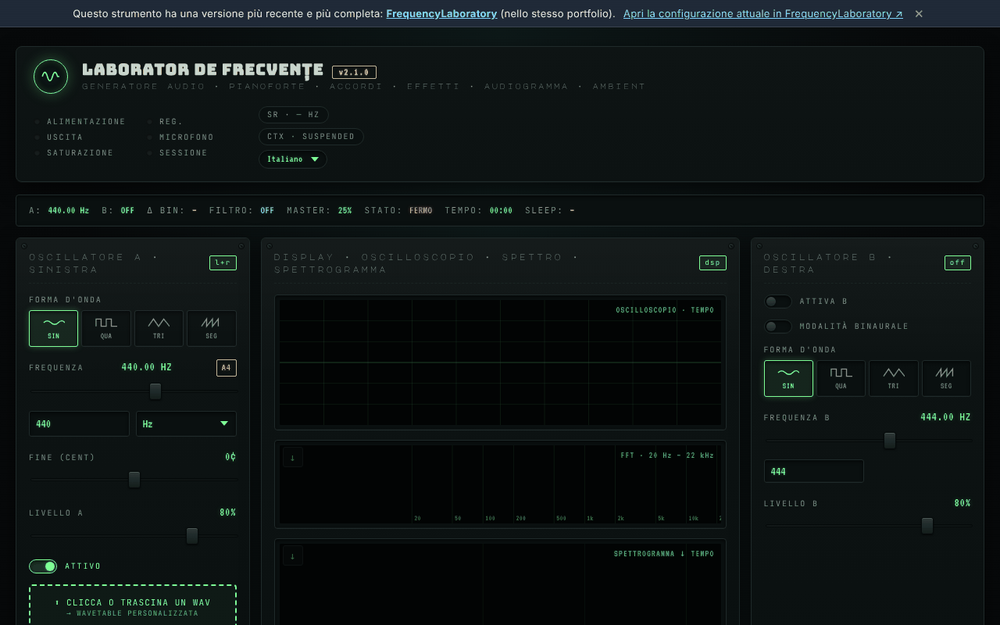

# Laboratorio di frequenze (generator-frecvente)

[English](README.md) · [Română](README.ro.md) · [Français](README.fr.md) · **Italiano** · [Español](README.es.md) · [Português](README.pt.md) · [Deutsch](README.de.md) · [Magyar](README.hu.md)

**Versione:** 2.2.8 · **Ultimo aggiornamento:** 2026-10-23

Lingue dell'interfaccia: **Română, English, Français, Italiano, Español, Português (PT), Deutsch, Magyar**

**Online / demo:** https://chiuta.github.io/generator-frecvente/

Strumento audio in un unico file HTML (`index.html`), eseguito nel browser tramite la Web Audio API: oscillatori A/B (compresa la modalità binaurale), sequencer, equalizzatore, suoni ambientali, preset di frequenze, registrazione, misurazioni con il microfono e un test dell'udito indicativo.

**Contenuto informativo/educativo; non sostituisce il parere medico.** Le categorie «Solfeggio» e «Schumann» provengono da tradizioni moderne (New Age) e non hanno alcuna validazione scientifica; non si promettono effetti terapeutici. Il test dell'udito mostra una soglia relativa e non è un audiogramma medico. I preset con nomi come «liberazione dalla paura» o simili non hanno alcun effetto medico dimostrato. In caso di acufene o di problemi di udito consulta un otorinolaringoiatra. Tieni il volume basso e usa le cuffie con prudenza.

## Utilizzo
Apri `index.html` in un browser moderno (oppure la versione pubblicata tramite GitHub Pages). Premi «Start» per avviare il suono; le scorciatoie sono descritte nella pagina (tasto `?`).

## Dati e privacy
Verificato tramite audit: la pagina non effettua richieste di rete (non ci sono `fetch`, CDN né font esterni; i font sono incorporati). Il microfono viene usato solo se lo attivi esplicitamente, e il segnale è elaborato localmente. Le impostazioni possono essere conservate in `localStorage`. Gli unici link esterni sono quelli per il sostegno volontario e il sito dell'autore.

## Limitazioni
Il comportamento dipende dal browser (Web Audio, MIDI, AudioWorklet). Nello stesso portfolio esiste una versione più recente dello strumento: [FrequencyLaboratory](https://chiuta.github.io/FrequencyLaboratory/) (il link compare anche nel banner della pagina).

## Cronologia / Changelog
- **2.2.7 — 2026-10-22:** Bersagli touch: la casella «mostra armoniche sullo spettro» è in un’etichetta alta almeno 24 px. Nuovo audit a 360 e 1366 px (stato iniziale, sezioni espanse, pannelli nascosti): non restano bersagli sotto 24 px né testo sotto 12 px.

### 2.2.6 — 2026-10-22
- fff-kit 1.1.4: bersagli touch e testo minimo; bersagli touch/testo corretti

### 2.2.5 — 2026-10-22
- fff-kit 1.1.2: PBKDF2 a 600.000 iterazioni, protezione anti-clickjacking.

### 2.2.4 — 2026-10-22

chiavi `localStorage` proprie con il prefisso `generator-frecvente.`, migrate automaticamente dalle vecchie chiavi `lab_frecv_` (che andavano in collisione con FrequencyLaboratory sulla stessa origine: preset e tema si sovrascrivevano a vicenda); l’etichetta tecnica elenca ora le 8 lingue dell’interfaccia; i campi file nascosti hanno un’etichetta in ogni lingua; focus da tastiera visibile; il link del banner va a capo sugli schermi stretti. rifiniture per mobile e accessibilità: testo di almeno 12 px e aree tattili di almeno 24 px.

### 2.2.3 — 2026-10-22
- Circa 50 attributi aria-label/title rimasti in inglese (anche in rumeno) sono tradotti nelle 8 lingue; i nomi predefiniti delle fasi («Fase 1/4») seguono la lingua dell'interfaccia e si aggiornano subito al cambio.

### 2.2.2 — 2026-10-22
- Il titolo del pannello « tema · condivisione » è ora tradotto anche in rumeno (« partajare »).

- 2.1.1 — 2026-10-19: nel banner, un link «Apri la configurazione corrente in FrequencyLaboratory» (lo stato corrente nel frammento `#state=`, in una nuova scheda; senza richieste di rete).
- 2.1.0 — 2026-10-14: backup ed etichettatura dei dati (fff-kit).

- 2.0.4 — 2026-10-12: la versione e la data dell'ultimo aggiornamento sono mostrate nell'applicazione
- All'avvio non compaiono più le 6 notifiche «v2.0: …» (note di versione che si sovrapponevano all'interfaccia per ~10 s, soprattutto su mobile); resta soltanto il suggerimento unico del primo avvio. La pila di notifiche è limitata a 3 (la più vecchia viene rimossa).
- Libreria di preset: campo di ricerca in tutte le 6 categorie (nome, descrizione, frequenza; senza distinzione dei segni diacritici, più termini), con contatore e messaggio in caso di zero risultati; premendo l'etichetta di una categoria la ricerca viene svuotata. CSP: `script-src` tramite hash SHA-256, senza `'unsafe-inline'` (blob: resta consentito per AudioWorklet/worker).
- Il contenuto è ora racchiuso in `<main>`, il banner «versione più recente» è un `aside` e i titoli nel pannello delle note sono h2 (ordine h1 → h2 corretto); il campo BPM del metronomo ha un'etichetta accessibile. axe-core: 0 violazioni a 1280 e 360 px.
- Sugli schermi stretti (360 px) il pannello delle note non provoca più lo scorrimento orizzontale della pagina.
- Le notifiche (toast) sono ora una regione `status` per i lettori di schermo.
- Il numero di versione è stato aggiornato nel titolo, nell'intestazione e nel piè di pagina (v2.0 → v2.0.1 → v2.0.2). La versione più recente resta [FrequencyLaboratory](https://chiuta.github.io/FrequencyLaboratory/).

## Licenza
MIT, secondo l'intestazione di `index.html`; vedi `LICENSE`.

Audit: 2026-10-10
