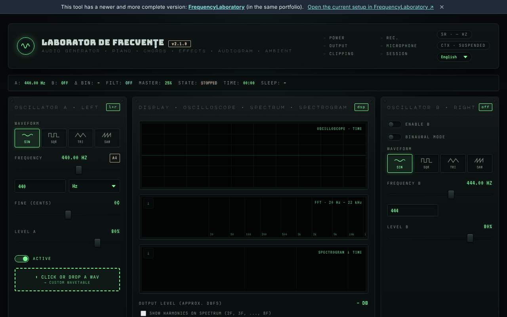

# Frequency Laboratory (generator-frecvente)

**English** · [Română](README.ro.md) · [Français](README.fr.md) · [Italiano](README.it.md) · [Español](README.es.md) · [Português](README.pt.md) · [Deutsch](README.de.md) · [Magyar](README.hu.md)

**Version:** 2.2.0 · **Last updated:** 2026-10-19

Interface languages: **Română, English, Français, Italiano, Español, Português (PT), Deutsch, Magyar**

**Live / demo:** https://chiuta.github.io/generator-frecvente/

A single-file HTML audio tool (`index.html`) that runs in the browser through the Web Audio API: A/B oscillators (including binaural mode), sequencer, EQ, ambient sounds, frequency presets, recording, microphone measurements and an indicative hearing test.

**Informational/educational content; it does not replace medical advice.** The "Solfeggio" and "Schumann" categories come from modern (New Age) traditions and have no scientific validation; no therapeutic effects are promised. The hearing test shows a relative threshold and is not a medical audiogram. Presets with names such as "release from fear" or similar have no proven medical effect. For tinnitus or hearing problems, consult an ENT doctor. Keep the volume low and use headphones with caution.

## Usage
Open `index.html` in a modern browser (or use the version published through GitHub Pages). Press "Start" to start the sound; the shortcuts are described on the page (key `?`).

## Data and privacy
Verified by audit: the page makes no network requests (there is no `fetch`, CDN or external fonts; the fonts are embedded). The microphone is used only if you enable it explicitly, and the signal is processed locally. Settings may be kept in `localStorage`. The only external links are the voluntary support links and the author's website.

## Limitations
Behaviour depends on the browser (Web Audio, MIDI, AudioWorklet). A newer version of the tool exists in the same portfolio: [FrequencyLaboratory](https://chiuta.github.io/FrequencyLaboratory/) (the link also appears in the banner on the page).

## History / Changelog

- 2.1.1 — 2026-10-19: in the banner, an "Open the current configuration in FrequencyLaboratory" link (the current state in the `#state=` fragment, new tab; no network requests).
- 2.1.0 — 2026-10-14: Backup and data labelling (fff-kit).

- 2.0.4 — 2026-10-12: the version and the last-updated date are shown in the app
- At start-up the 6 "v2.0: …" notifications no longer appear (release notes that overlapped the interface for ~10 s, especially on mobile); only the single first-start hint remains. The notification stack is limited to 3 (the oldest is removed).
- Preset library: search field across all 6 categories (name, description, frequency; diacritic-insensitive, multiple terms), with a counter and a message for zero results; pressing a category label clears the search. CSP: `script-src` by SHA-256 hash, without `'unsafe-inline'` (blob: remains allowed for AudioWorklet/worker).
- The content is now wrapped in `<main>`, the "newer version" banner is an `aside`, and the headings in the notes panel are h2 (correct h1 → h2 order); the metronome's BPM field has an accessible label. axe-core: 0 violations at 1280 and 360 px.
- On narrow screens (360 px) the notes panel no longer causes horizontal scrolling of the page.
- Notifications (toasts) are now a `status` region for screen readers.
- The version number was raised in the title, header and footer (v2.0 → v2.0.1 → v2.0.2). The newer version remains [FrequencyLaboratory](https://chiuta.github.io/FrequencyLaboratory/).

## Licence
MIT, according to the header of `index.html`; see `LICENSE`.

Audit: 2026-10-10
