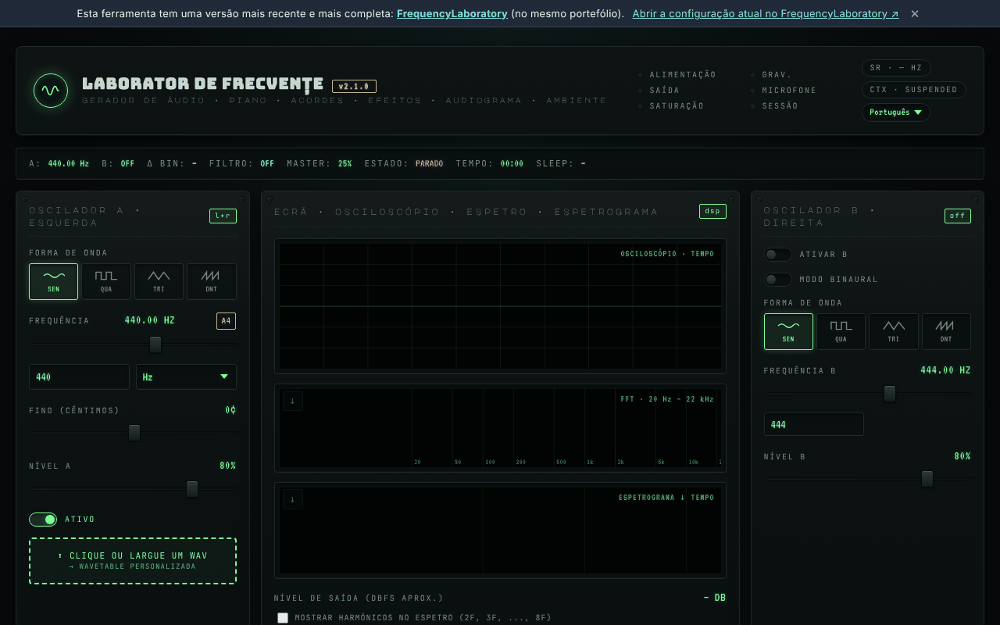

# Laboratório de Frequências (generator-frecvente)

[English](README.md) · [Română](README.ro.md) · [Français](README.fr.md) · [Italiano](README.it.md) · [Español](README.es.md) · **Português** · [Deutsch](README.de.md) · [Magyar](README.hu.md)

**Versão:** 2.2.1 · **Última atualização:** 2026-10-19

Idiomas da interface: **Română, English, Français, Italiano, Español, Português (PT), Deutsch, Magyar**

**Online / demonstração:** https://chiuta.github.io/generator-frecvente/

Ferramenta de áudio num único ficheiro HTML (`index.html`), executada no navegador através da Web Audio API: osciladores A/B (incluindo o modo binaural), sequenciador, equalizador, sons ambiente, predefinições de frequências, gravação, medições com o microfone e um teste auditivo indicativo.

**Conteúdo informativo/educativo; não substitui o aconselhamento médico.** As categorias «Solfeggio» e «Schumann» provêm de tradições modernas (New Age) e não têm validação científica; não se prometem efeitos terapêuticos. O teste auditivo mostra um limiar relativo e não é um audiograma médico. As predefinições com nomes do tipo «libertação do medo» ou semelhantes não têm qualquer efeito médico comprovado. Em caso de acufenos ou de problemas de audição, consulte um médico otorrinolaringologista. Mantenha o volume baixo e use os auscultadores com prudência.

## Utilização
Abra `index.html` num navegador moderno (ou a versão publicada através do GitHub Pages). Prima «Start» para iniciar o som; os atalhos estão descritos na página (tecla `?`).

## Dados e privacidade
Verificado por auditoria: a página não faz pedidos de rede (não existem `fetch`, CDN nem tipos de letra externos; os tipos de letra estão incorporados). O microfone só é utilizado se o ativar explicitamente, e o sinal é processado localmente. As definições podem ser guardadas em `localStorage`. As únicas ligações externas são as de apoio voluntário e o sítio do autor.

## Limitações
O comportamento depende do navegador (Web Audio, MIDI, AudioWorklet). Existe uma versão mais recente da ferramenta no mesmo portefólio: [FrequencyLaboratory](https://chiuta.github.io/FrequencyLaboratory/) (a ligação aparece também no banner da página).

## Histórico / Changelog

- 2.1.1 — 2026-10-19: no banner, uma ligação «Abrir a configuração atual no FrequencyLaboratory» (o estado atual no fragmento `#state=`, num novo separador; sem pedidos de rede).
- 2.1.0 — 2026-10-14: cópia de segurança e etiquetagem de dados (fff-kit).

- 2.0.4 — 2026-10-12: a versão e a data da última atualização são apresentadas na aplicação
- No arranque deixam de aparecer as 6 notificações «v2.0: …» (notas de versão que se sobrepunham à interface durante ~10 s, sobretudo em dispositivos móveis); resta apenas a sugestão única de primeiro arranque. A pilha de notificações está limitada a 3 (a mais antiga é removida).
- Biblioteca de predefinições: campo de pesquisa em todas as 6 categorias (nome, descrição, frequência; sem distinção de diacríticos, vários termos), com contador e mensagem para zero resultados; ao premir a etiqueta de uma categoria, a pesquisa é limpa. CSP: `script-src` por hash SHA-256, sem `'unsafe-inline'` (blob: continua permitido para AudioWorklet/worker).
- O conteúdo está agora envolvido em `<main>`, o banner de «versão mais recente» é um `aside` e os títulos do painel de notas são h2 (ordem h1 → h2 correta); o campo BPM do metrónomo tem uma etiqueta acessível. axe-core: 0 violações a 1280 e 360 px.
- Em ecrãs estreitos (360 px), o painel de notas deixa de provocar deslocamento horizontal da página.
- As notificações (toasts) são agora uma região `status` para leitores de ecrã.
- O número de versão foi atualizado no título, no cabeçalho e no rodapé (v2.0 → v2.0.1 → v2.0.2). A versão mais recente continua a ser [FrequencyLaboratory](https://chiuta.github.io/FrequencyLaboratory/).

## Licença
MIT, conforme o cabeçalho de `index.html`; ver `LICENSE`.

Auditoria: 2026-10-10
