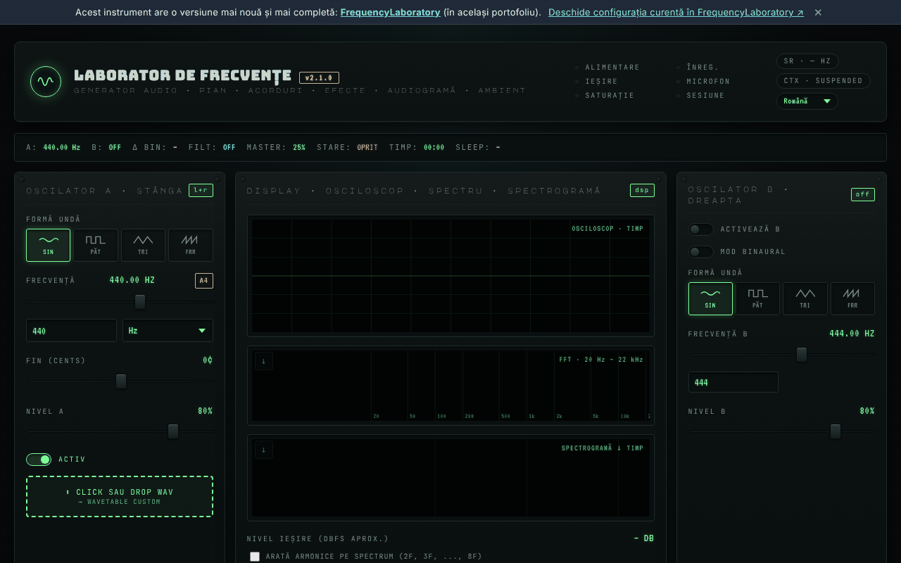

# Laborator de Frecvențe (generator-frecvente)

[English](README.md) · **Română** · [Français](README.fr.md) · [Italiano](README.it.md) · [Español](README.es.md) · [Português](README.pt.md) · [Deutsch](README.de.md) · [Magyar](README.hu.md)

**Versiune:** 2.2.2 · **Ultima actualizare:** 2026-10-22

Limbile interfeței: **Română, English, Français, Italiano, Español, Português (PT), Deutsch, Magyar**

**Live / demo:** https://chiuta.github.io/generator-frecvente/

Instrument audio într-un singur fișier HTML (`index.html`), rulat în browser prin Web Audio API: oscilatoare A/B (inclusiv mod binaural), secvențiator, EQ, sunete ambientale, preseturi de frecvențe, înregistrare, măsurători cu microfonul și un test auditiv orientativ.

**Conținut informativ/educațional; nu înlocuiește sfatul medical.** Categoriile „Solfeggio” și „Schumann” provin din tradiții moderne (New Age) și nu au validare științifică; nu se promit efecte terapeutice. Testul auditiv arată un prag relativ, nu este audiogramă medicală. Presetările cu nume de tip „eliberarea fricii” sau similar nu au efect medical dovedit. Pentru tinitus sau probleme de auz consultă un medic ORL. Ține volumul scăzut și folosește căști cu prudență.

## Utilizare
Deschide `index.html` într-un browser modern (sau varianta publicată prin GitHub Pages). Apasă „Start” pentru a porni sunetul; scurtăturile sunt descrise în pagină (tasta `?`).

## Date și confidențialitate
Verificat prin audit: pagina nu face cereri de rețea (nu există `fetch`, CDN sau fonturi externe; fonturile sunt încorporate). Microfonul este folosit doar dacă îl activezi explicit, iar semnalul este procesat local. Setările pot fi păstrate în `localStorage`. Singurele link-uri externe sunt cele de sprijin voluntar și site-ul autorului.

## Limitări
Comportamentul depinde de browser (Web Audio, MIDI, AudioWorklet). Există o versiune mai nouă a instrumentului în același portofoliu: [FrequencyLaboratory](https://chiuta.github.io/FrequencyLaboratory/) (linkul apare și în bannerul din pagină).

## Istoric / Changelog

### 2.2.2 — 2026-10-22
- Titlul panoului „temă · share” este acum tradus în română („partajare”).

- 2.1.1 — 2026-10-19: în banner, link „Deschide configurația curentă în FrequencyLaboratory” (starea curentă în fragmentul `#state=`, filă nouă; fără cereri de rețea).
- 2.1.0 — 2026-10-14: Copie de rezervă și etichetare date (fff-kit).

- 2.0.4 — 2026-10-12: versiunea și data ultimei actualizări sunt afișate în aplicație
- La pornire nu mai apar cele 6 notificări „v2.0: …” (note de versiune care se suprapuneau peste interfață ~10 s, mai ales pe mobil); a rămas doar sugestia unică de primul start. Stiva de notificări este limitată la 3 (cea mai veche se elimină).
- Bibliotecă de presetări: câmp de căutare în toate cele 6 categorii (nume, descriere, frecvență; fără diacritice, mai mulți termeni), cu contor și mesaj pentru zero rezultate; apăsarea unei etichete de categorie golește căutarea. CSP: `script-src` pe hash SHA-256, fără `'unsafe-inline'` (blob: rămâne permis pentru AudioWorklet/worker).
- Conținutul este acum încadrat în `<main>`, bannerul „versiune mai nouă” este `aside`, iar titlurile din panoul de notițe sunt h2 (ordinea h1 → h2 corectă); câmpul BPM al metronomului are etichetă accesibilă. axe-core: 0 violări la 1280 și 360 px.
- Pe ecrane înguste (360 px) panoul de notițe nu mai provoacă derulare orizontală a paginii.
- Notificările (toast) sunt acum regiune `status` pentru cititoare de ecran.
- Numărul de versiune a fost ridicat în titlu, antet și subsol (v2.0 → v2.0.1 → v2.0.2). Versiunea mai nouă rămâne [FrequencyLaboratory](https://chiuta.github.io/FrequencyLaboratory/).

## Licență
MIT, conform antetului din `index.html`; vezi `LICENSE`.

Audit: 2026-10-10
